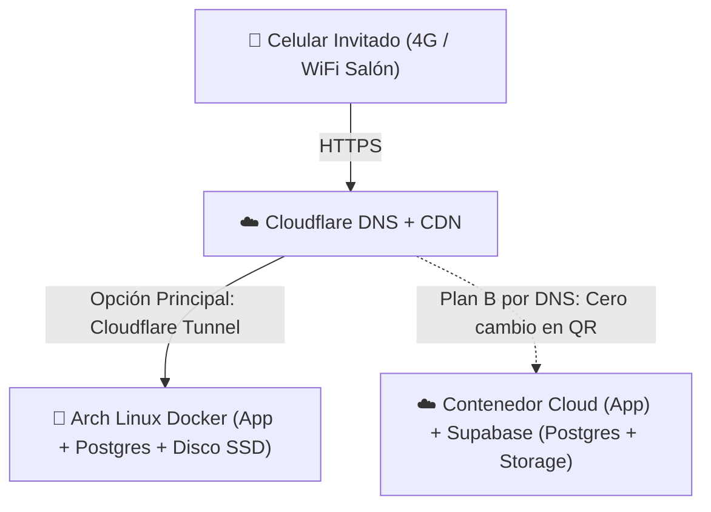

# Arquitectura Técnica y Stack — Wedding App

## 1. Visión Arquitectónica

Monolito modular **Same-Origin** organizado en un monorepo liviano con `pnpm workspaces`. Prioriza simplicidad operativa, tipado estricto de punta a punta en TypeScript y **portabilidad total por variables de entorno** entre el servidor local **Arch Linux (Ryzen 5 3600G)** y un entorno **Cloud + Supabase** detrás de **Cloudflare DNS**.



---

## 2. Estructura del Monorepo (`pnpm workspaces`)

Sin herramientas pesadas de orquestación innecesarias; solo 3 paquetes con responsabilidades nítidas:

```text
/
├── apps/
│   ├── web/                # React + Vite + Tailwind CSS + React Router (Mobile-First SPA)
│   └── api/                # Node.js + Express + Drizzle ORM + PhotoStorage Adapters
├── packages/
│   └── shared/             # Esquemas Zod, contratos HTTP, constantes y tipos compartidos
├── docs/                   # Especificaciones, ADRs y guías operativas
├── docker-compose.yml      # Stack completo para Arch Linux (api+web, postgres, cloudflared)
├── Dockerfile              # Build multi-stage: compila shared + web + api en una sola imagen
├── GLOSSARY.md             # Lenguaje ubicuo del dominio
└── AGENTS.md               # Reglas operativas para agentes de programación
```

### Regla Same-Origin en Producción
- En **desarrollo local**, Vite (`:5173`) hace proxy de `/api` y `/media` hacia Express (`:3000`).
- En **producción**, el contenedor de `apps/api` sirve tanto los endpoints `/api/*` como los archivos estáticos compilados de `apps/web` bajo el **mismo dominio y puerto**. Esto elimina configuraciones frágiles de CORS y garantiza que **Safari en iOS** acepte siempre las cookies `HttpOnly` de sesión.

---

## 3. Stack Tecnológico y Justificación

| Capa | Tecnología Elegida | Justificación | Alternativas Descartadas |
| :--- | :--- | :--- | :--- |
| **Frontend** | `React 19` + `Vite` + `React Router` + `Tailwind CSS` | Rápido de iterar, rutas reales que respetan el botón "Atrás" del celular, control directo del pipeline de compresión en cliente. | *Next.js / Vercel Serverless* (límite de 4.5 MB en body complica subidas en lote; complejidad innecesaria de RSC). *Astro* (casi toda la app requiere estado interactivo). |
| **Compresión Cliente** | Web Worker / Canvas (`browser-image-compression` + `heic2any` lazy-loaded) | Convierte HEIC de iPhone y baja fotos de ~10 MB a ~400 KB antes de tocar la red móvil del salón; librería HEIC se descarga solo si el archivo es `.heic`. | *Subida cruda + Sharp pesado en servidor* (falla por timeout en 4G saturado). |
| **Backend** | `Node.js 22 LTS` + `Express` + `TypeScript` | Ecosistema maduro para `multipart/form-data` (`multer`), cookies firmadas y middlewares simples de seguridad. | *Microservicios / NestJS* (sobreingeniería para un dominio acotado de 4 tablas). |
| **Base de Datos & ORM** | `PostgreSQL 16` + `Drizzle ORM` | 100% TypeScript nativo sin binarios pesados en Docker ni paso `generate`; queries SQL de conteo de votos en 1 solo viaje; compatible con Postgres local y Supabase. | *Prisma ORM* (binario pesado en Docker, múltiples queries en conteos). |
| **Almacenamiento** | Seam `PhotoStorage` (`LocalDiskAdapter` \| `SupabaseStorageAdapter`) | Permite guardar directo en los 480 GB del Arch Linux a costo $0 o switchear a Supabase Storage cambiando `STORAGE_DRIVER` en `.env`. | Acoplar el frontend directo al SDK de Supabase (rompería el modo local en Arch Linux). |
| **Validación** | `Zod` (en `packages/shared`) | Fuente única de validación para formularios del cliente y payloads de la API. | Duplicar interfaces manuales en front y back. |
| **Procesamiento Miniaturas** | `sharp` (uso mínimo en `apps/api`) | Recibe la foto ya liviana (~400 KB) del cliente, verifica que sea una imagen real decodificable, limpia metadatos EXIF sensibles (GPS) y genera un *thumbnail* de ~40 KB (`400px`) para que la grilla cargue al instante. | Servir fotos de 400 KB x 100 celdas en la grilla móvil. |

---

## 4. Diseño de Módulos Profundos y Seams (`codebase-design`)

Aplicamos la regla: **introducir un *seam* (interfaz con adaptadores intercambiables) únicamente donde el comportamiento varía realmente**.

1. **`PhotoStorage` (Seam real — 2 adaptadores de producción + 1 de test):**
   - **Interfaz pequeña:** `putPhoto({ id, fullBuffer, thumbBuffer, mimeType })`, `deletePhoto(id)`, `getPhotoUrl(id, variant)` (o stream local).
   - **Adaptadores:**
     - `LocalDiskPhotoStorage`: Escribe en `/data/photos/{full,thumb}/{id}.webp` en Arch Linux y los sirve con cabeceras `Cache-Control: public, max-age=31536000, immutable` (aprovechando caché gratis de Cloudflare CDN).
     - `SupabasePhotoStorage`: Sube ambos buffers al bucket privado/público configurado en Supabase.
     - `InMemoryPhotoStorage`: Adaptador liviano para correr tests de integración en milisegundos sin tocar disco ni red.
2. **`ImageIngestPipeline` (Módulo profundo):**
   - Esconde detrás de una sola función toda la validación de magic-bytes, strip de coordenadas GPS EXIF por privacidad, generación de miniatura `400px` y persistencia coordinada entre `PhotoStorage` y PostgreSQL (si falla la base, limpia el archivo huérfano).
3. **Acceso a Datos Directo con Drizzle (Sin repositorios "pass-through" vacíos):**
   - Como PostgreSQL es el único motor en ambos entornos (Arch Linux Docker y Supabase), no creamos interfaces abstractas `IPhotoRepository` que solo copian métodos de Drizzle. Los módulos de dominio reciben la instancia `db` de Drizzle inyectada para poder testearse contra una base de test limpia.

---

## 5. Manejo de Errores y Observabilidad

- **Formato uniforme de error HTTP (`packages/shared`):** `{ error: { code: string, message: string } }` con mensajes pensados para el invitado en español claro.
- **Logging estructurado (`pino`):** Logs JSON livianos en `stdout` (capturados automáticamente por Docker en Arch Linux o por el PaaS cloud), registrando `requestId`, ruta, latencia, `guestSessionId` (abreviado, sin exponer tokens ni cookies) y errores de subida.
- **Endpoint `/api/health`:** Verifica conectividad real con PostgreSQL (`SELECT 1`) y permisos de escritura en `PhotoStorage` para monitoreo simple antes y durante el casamiento.

---

## 6. Índice de Decisiones Arquitectónicas (ADRs)

Todas las decisiones estructurales viven en [`docs/adr/`](./adr/):
- [0001 — Single-Event Architecture](./adr/0001-single-event-architecture.md)
- [0002 — Guest Session Identity Model](./adr/0002-guest-session-identity.md)
- [0003 — Reactive Moderation and Lightweight Moderator Controls](./adr/0003-reactive-moderation-and-lightweight-admin.md)
- [0004 — Client-Side Image Compression and Format Normalization](./adr/0004-client-side-image-optimization.md)
- [0005 — Modular Hub Navigation and Incremental Section Scope](./adr/0005-modular-hub-and-mvp-sections.md)
- [0006 — Contest Voting Mechanics and Venue Wi-Fi NAT Protection](./adr/0006-contest-voting-and-venue-nat-protection.md)
- [0007 — Shared QR Gate Token and Photo Lifecycle Policy](./adr/0007-shared-qr-gate-and-photo-lifecycle.md)
- [0008 — Daylight High-Contrast Mobile-Only UX](./adr/0008-daylight-mobile-only-ux.md)
- [0009 — Dual Portable Hosting Behind Cloudflare DNS](./adr/0009-dual-portable-hosting-architecture.md)
- [0010 — Lean Monorepo Stack: React, Express, PostgreSQL, and Drizzle ORM](./adr/0010-monorepo-react-express-drizzle-stack.md)
