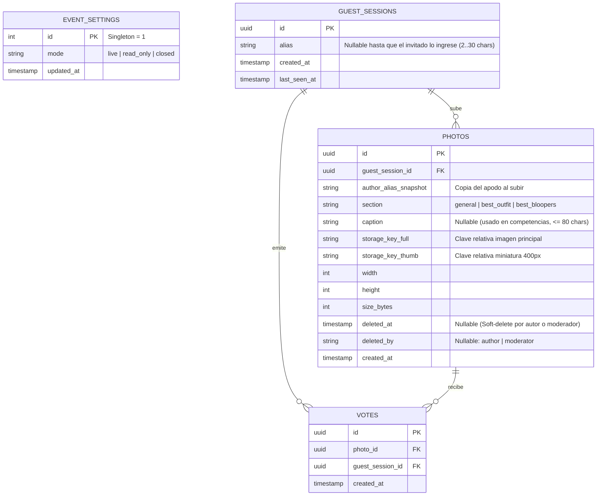

# Modelo de Datos — Wedding App

## 1. Principios del Esquema

- **Motor:** PostgreSQL 16 gestionado mediante migraciones versionadas de **Drizzle ORM** (`apps/api/src/db/schema.ts`).
- **Simplicidad Single-Event:** Sin `tenant_id` ni tablas de cuentas/usuarios complejas; solo **4 tablas** cubren todo el ciclo de vida del casamiento.
- **Unificación inteligente de fotos:** Tanto los recuerdos del *Muro General* como las *Postulaciones* de competencias (*Best Outfit*, *Best Bloopers*) comparten la misma tabla `photos` diferenciadas por su columna `section`. Esto evita duplicar el pipeline de almacenamiento/moderación y facilita descargar el álbum completo de la boda al terminar.

---

## 2. Diagrama Entidad-Relación

---

## 3. Detalle de Tablas, Constraints e Índices

### 3.1 `event_settings` (Fila única `id = 1`)
Guarda el estado dinámico operable por el Moderador durante y después de la fiesta:
- `id`: `integer` PK (`CHECK (id = 1)` para garantizar fila única).
- `mode`: Enum `'live' | 'read_only' | 'closed'` (default `'live'`).
- *(La visibilidad de tarjetas como `best_bloopers` o `bingo` puede definirse por variables/config estática o columnas booleanas/enum simples en esta misma fila).*

### 3.2 `guest_sessions`
Representa la "pulsera individual" de cada teléfono que ingresó por el QR:
- `id`: `uuid` PK generado por el servidor y almacenado en cookie `HttpOnly` firmada.
- `alias`: `varchar(30)` nullable (se completa la primera vez que el invitado participa; si lo corrige, actualiza su sesión).
- `created_at`, `last_seen_at`: `timestamptz`.

### 3.3 `photos`
Almacena tanto fotos del *Muro General* como *Postulaciones* de competencias:
- `id`: `uuid` PK (v7 o v4).
- `guest_session_id`: `uuid` FK → `guest_sessions.id` (`NOT NULL`). Permite verificar propiedad exacta al borrar fotos propias.
- `author_alias_snapshot`: `varchar(30)` (`NOT NULL`). Evita joins innecesarios o pérdida de contexto histórico.
- `section`: Enum `'general' | 'best_outfit' | 'best_bloopers'` (`NOT NULL`).
- `caption`: `varchar(80)` nullable (solo permitido cuando `section != 'general'`).
- `storage_key_full` / `storage_key_thumb`: `varchar(255)` (`NOT NULL`), rutas agnósticas del driver (ej. `full/<uuid>.webp` y `thumb/<uuid>.webp`), de modo que sirvan igual en disco local o Supabase.
- `width`, `height`, `size_bytes`: `integer` (`NOT NULL`) para layout estable sin saltos y auditoría de peso.
- `deleted_at`: `timestamptz` nullable (**Soft Delete** en base + borrado físico configurable o diferido, evitando romper referencias en vuelo y permitiendo auditoría si alguien borró por accidente).
- **Índices:**
  - `idx_photos_section_created` en `(section, created_at DESC) WHERE deleted_at IS NULL` → acelera tanto el *Muro General* como la vista *Recientes* de competencias.

### 3.4 `votes`
Registra cada corazón ❤️ en una competencia:
- `id`: `uuid` PK.
- `photo_id`: `uuid` FK → `photos.id` (`ON DELETE CASCADE`, `NOT NULL`).
- `guest_session_id`: `uuid` FK → `guest_sessions.id` (`ON DELETE CASCADE`, `NOT NULL`).
- `created_at`: `timestamptz` (`NOT NULL`).
- **Constraint crítico anti-duplicados:**
  - `UNIQUE (photo_id, guest_session_id)` → Garantiza a nivel motor de base de datos que ninguna sesión pueda insertar dos votos para la misma foto, incluso ante doble clic rápido o condiciones de carrera.
- **Índice de conteo:**
  - `idx_votes_photo_id` en `(photo_id)` para agregaciones instantáneas del *Top Ranking*.

---

## 4. Consultas Clave y Escalabilidad

Para un casamiento (ej. 100–300 invitados, 500–3.000 fotos, 5.000 votos):
- **Listado paginado por cursor (`created_at, id`):** Evita saltos o fotos duplicadas en la grilla cuando otros invitados están subiendo fotos nuevas al mismo tiempo en plena fiesta.
- **Ranking en 1 query (Drizzle):** `SELECT photos.*, COUNT(votes.id) AS vote_count, BOOL_OR(votes.guest_session_id = :currentSession) AS voted_by_me FROM photos LEFT JOIN votes ... WHERE section = 'best_outfit' AND deleted_at IS NULL GROUP BY photos.id` — en PostgreSQL sobre menos de 5.000 filas resuelve en `< 2 ms`.
